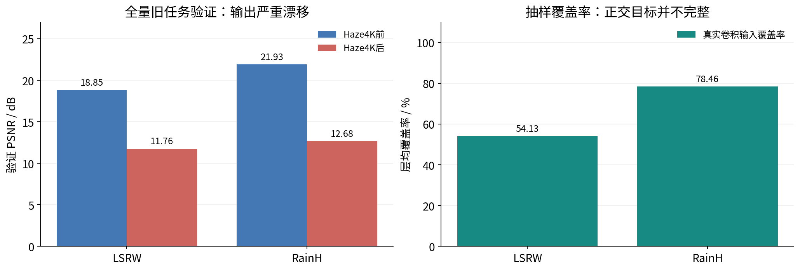
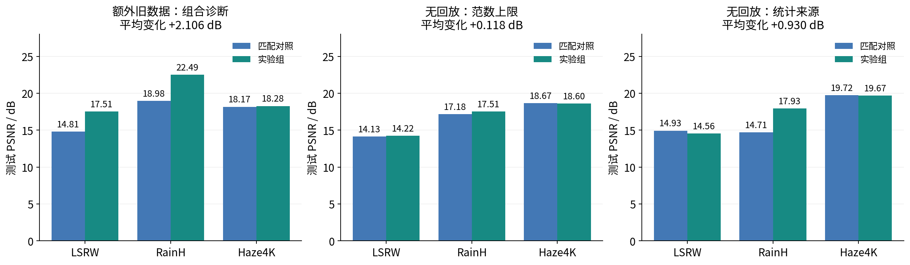
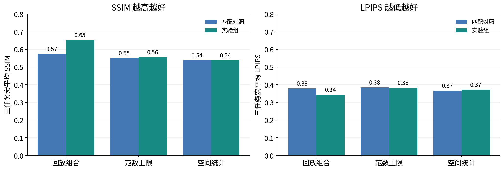
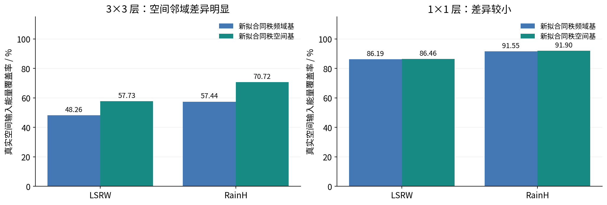
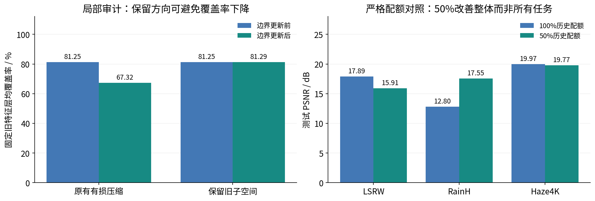
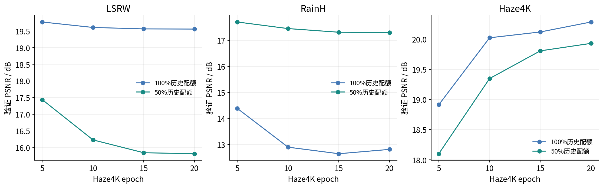
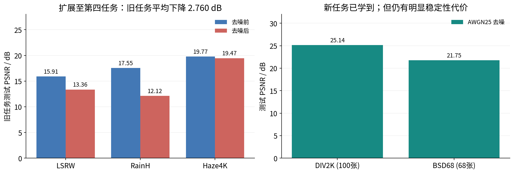
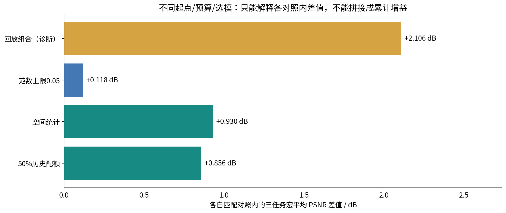
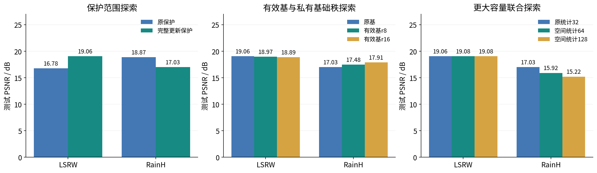

# 更换模型前的正交LoRA研究总结

范围：2026-10-29至2026-11-05的干净配对实验与后续诊断；不包含stable_v1结构改动。
汇编日期：2026-11-07。适合约10–15分钟组会汇报。

## 核心结论

空间统计相对频域匹配对照的三任务宏平均PSNR提高0.9298 dB；
50%历史配额相对100%汇总配额提高0.8559 dB，但并非每个任务都改善。
第四任务去噪加入后旧三任务平均下降2.7598 dB，因此尚未解决长期遗忘。
上述收益属于不同匹配对照，不能相加，也不能将额外旧数据回放组当作无回放方法。

## 汇报讲稿与图表

### 1. 正交 LoRA 图像复原：阶段研究汇报

更换网络结构前的实验总结｜正式结果截至 2026-11-05｜汇编 2026-11-07

- 研究目标：不使用旧数据回放，以有限子空间记忆保护连续图像复原能力。
- 主线：完整更新正交 → 输出稳定性诊断 → 空间统计 → 历史方向配额 → 第四任务检验。
- 阶段结论：空间匹配与平衡配额均有收益，但有限记忆仍未解决长期遗忘。
- 汇报范围：旧 NAFNet 风格骨干；不包含 stable_v1 的结构改动及其训练结果。

口径/来源：数据来自本地正式 JSON/日志；排除 smoke/capacity 测试的质量指标。

### 2. 01｜先明确比较协议，而不是拼接一张排行榜

数据清洗与可复现实验是本阶段的重要工作

- 干净配对：LSRW 训练/验证/测试=5036/564/50；RainH=1128/126/100；Haze4K=2700/300/1000。
- 三任务顺序固定；训练留出集选模；正式测试在任务边界执行。PSNR/SSIM按[0,1]截断，LPIPS沿用原始输出协议。
- 短程主对照：batch64、patch128、新任务20轮、AdamW、lr=2e-4、L1+0.1 LPIPS、严格FP32。
- 回放对照按已见任务验证均值选模；其余短程对照只按新任务验证PSNR选模。历史长程基线为batch16、400轮。
- 平均PSNR为任务宏平均；遗忘按旧任务历史阶段最佳测试PSNR减当前PSNR、取非负值后，对旧任务平均。
- 单种子短程结果仅支持当前配置下的观察；不同实验家族不直接排名，也不能宣称统计显著。

### 3. 02｜问题确认：正交有效，但旧任务输出并不稳定

历史 clean-effective-r16：验证全量配对审计；不是新增训练结果

- LSRW 验证PSNR下降7.087 dB；RainH下降9.257 dB。下降超过1 dB的图像分别为483/564、123/126。
- 固定参数未变；增量与A@B一致；GPM更新前向误差为0。证据不支持将退化归于冻结失败或重复合并。
- 投影泄漏约1e-7仍可能伴随真实输入未覆盖分量响应；抽样覆盖率不是全网络总体能量比例。

口径/来源：来源：output_stability_20261104_full/stability.json；覆盖率每任务8张验证图、每层每图最多128 patches。

### 4. 03｜匹配消融：哪些路径有效，哪些效果有限？

每个子图只在自身匹配对照内解释；前三任务最终测试

- 回放组合平均 +2.106 dB：额外旧数据与计算有效，但不是最终无回放路线。
- 范数上限0.05平均 +0.118 dB：改善较小，Haze4K略下降，不能视为解决遗忘。
- 空间统计平均 +0.930 dB：RainH明显改善，LSRW并未同步改善。

口径/来源：回放为监督回放＋蒸馏＋范围约束的组合；两个旧任务各64张训练图，不可拆分归因。

### 5. 04｜不只看PSNR：同时检查SSIM与LPIPS

同一组正式测试数据；均为三个任务各指标的宏平均

- 空间统计的PSNR收益没有转化为全部感知指标提升，应承认指标之间的权衡。
- 原始输出仍有极端值；截断后的PSNR/SSIM不能代替原始输出稳定性诊断。

口径/来源：LPIPS越低越好；不能把含异常值的原始LPIPS与截断后LPIPS混作同协议。

### 6. 05｜机制证据：频域patch并不等于真实卷积输入

维度和排列一致不代表统计主子空间相同；重点差异在3×3邻域

- 固定模型与相同秩，在分离的TRAIN拟合组/VALIDATION评分组上比较两类记忆基。
- 空间基在3×3层覆盖率高约9.47/13.28个百分点；1×1层差异小于0.4个百分点。
- 这属于有限抽样机制证据；局部反事实投影并非全网络训练效果，也不能外推等比例PSNR收益。

口径/来源：来源：gpm_coordinate_audit_20261104/audit.json；每任务8个拟合TRAIN组、16个VALIDATION组。

### 7. 06｜保留更早方向，不等于更好地保护所有历史任务

固定32维记忆：从“全部保留”转向“历史池与当前残差平衡”

- 局部审计：压缩使旧特征覆盖率81.25%→67.32%；保留旧空间为81.25%→81.29%，不是准确率或方向数量比例。
- 严格配额对照：50%相对100%三任务平均 +0.856 dB；遗忘3.358→1.976 dB。
- 代价：LSRW下降1.984 dB；收益：RainH提升4.750 dB。50%不是每个历史任务各占50%，也不是全任务均优。

口径/来源：左：固定RainH末模型下LSRW留出特征的边界审计。右：同RainH权重、同协方差，只改历史配额。

### 8. 07｜验证曲线：历史保护存在稳定性—可塑性取舍

同一RainH边界，Haze4K训练第5/10/15/20轮的验证结果

- 100%历史配额偏向维持更早LSRW特征，RainH在后续训练中明显退化。
- 50%配额改善RainH保持，但放弃部分LSRW优势；Haze4K学习曲线也随保护空间改变。
- 两组选模均只看Haze4K验证PSNR；旧任务曲线用于诊断，不参与优化。

口径/来源：来源：memory_balanced50_b64/history.json 与 memory_balanced100_b64/history.json；验证不是测试。

### 9. 08｜第四任务检验：局部改进还不具备长期保证

LSRW → RainH → Haze4K → AWGN25去噪；未完成GOPRO正式训练

- 加入去噪后，旧三任务平均17.742→14.983 dB，下降2.760 dB；RainH下降5.431 dB。
- 去噪DIV2K=25.136 dB、BSD68=21.753 dB；新任务能学习，但旧任务保持再次恶化。
- 四任务平均17.179包含去噪，不能直接与三任务平均17.742比较来衡量遗忘。

口径/来源：去噪采用512窗口/64重叠推理及面积加权patch LPIPS；旧三任务评估方式保持不变。

### 10. 09｜阶段结论：三个证据支持的判断

只报告各自匹配对照内的收益，不构造累计增益

- ① 对保存子空间正交 ≠ 对旧任务函数保持不变；统计不匹配、有限容量与特征漂移共同构成风险。
- ② 空间统计与平衡配额是值得保留的无回放机制；更新范数上限单独作用较弱。
- ③ 当前结果还不能宣称消除遗忘、五任务有效或达到最佳整体复原性能。

口径/来源：回放诊断不计为无回放创新；各家族起点、训练预算和选模规则不同。

### 11. 10｜汇报可用的结论与后续计划

正交LoRA仍是核心创新方向；结构修改的研究留在下一阶段单独汇报

- 推荐表述：完成了无回放正交LoRA的机制排查与匹配消融，确认空间统计匹配和平衡记忆分配能改善阶段性保持。
- 避免表述：已解决灾难性遗忘；50%配额是全局最优；所有实验增益可相加；回放提升证明正交机制有效。
- 后续验证：记录旧任务逐层/逐轮漂移；检查异常输出；在匹配骨干、预算、选模下复验，并补多种子。
- 旧空间配额是历史池级启发式，不具备逐任务公平保证；继续扩展任务前须检验保护方向的长期覆盖。
- 结果可追溯：随附CSV、全部来源SHA256、PNG/SVG图表、可重建脚本。训练产物未修改。

### 12. 附录｜早期探索如何引出后续研究

2026-10-28/29旧配对协议探针：只作为研究过程，不与干净配对主结果混排

- 完整更新保护改善LSRW保持，但牺牲RainH学习；促使后续同时检查稳定性与可塑性。
- 有效基r16提高RainH适应能力，但仍有旧任务代价；后续主实验沿用投影后有效基与私有基础秩16。
- 更大容量联合探索没有明显收益；32/64/128组同时涉及统计来源等差异，不能单独归因为容量。

口径/来源：来源：forgetting_probe_20261028、basis_study_20261029、gpm_study_20261029；旧配对探针，不作正式基准。

## 正式三任务结果总表（不是统一排行榜）

| 实验 | LSRW PSNR | RainH PSNR | Haze4K PSNR | 宏平均PSNR | 遗忘 |
|---|---:|---:|---:|---:|---:|
| 长程频域基线（背景） | 10.5344 | 12.9171 | 20.0952 | 14.5156 | 9.2481 |
| 回放实验匹配对照 | 14.8072 | 18.9797 | 18.1679 | 17.3183 | 4.0804 |
| 回放＋蒸馏＋范围约束 | 17.5086 | 22.4894 | 18.2750 | 19.4243 | 0.9749 |
| 范数约束匹配对照 | 14.1349 | 17.1759 | 18.6663 | 16.6590 | 5.3185 |
| 逐层增量上限0.05 | 14.2213 | 17.5096 | 18.5991 | 16.7767 | 5.1085 |
| 频域统计32 | 14.9301 | 14.7111 | 19.7238 | 16.4550 | 3.8820 |
| 空间统计32 | 14.5581 | 17.9281 | 19.6682 | 17.3848 | 2.4612 |
| 逐批保留旧方向 | 17.8824 | 12.8067 | 19.9679 | 16.8857 | 3.3597 |
| 汇总式100%历史配额 | 17.8919 | 12.7997 | 19.9677 | 16.8864 | 3.3585 |
| 汇总式50%历史配额 | 15.9076 | 17.5499 | 19.7695 | 17.7423 | 1.9755 |

注意：长程基线与短程分支不等预算；回放组按已见任务平均验证选模，范数/统计/配额组只按新任务选模。
逐批preserve与汇总式100%不是同一更新算法，二者只可作为背景参考；配额的严格对照为50%与100%汇总两组。

## 四任务扩展

去噪后旧任务宏平均：14.9825 dB；相对去噪前变化-2.7598 dB。
GOPRO数据划分和入口已准备，但截止本报告没有正式GOPRO训练结果，不把“具备五任务代码”写成“完成五任务实验”。

## 早期探索为何不放入主对比表

2026-10-28/29的完整更新保护、GPM64/128与有效秩探针属于干净配对协议确立前的探索。
这些探针启发了完整更新保护和有效基/私有基础秩16，但不与干净配对正式结果混排。
主表也排除smoke、capacity与仅离线拟合基的PSNR“推断”。

## 可复现与来源

`experiment_metrics.csv`保留各正式实验全部PSNR/SSIM/LPIPS；`sources.json`记录来源路径与SHA256。
重建：在仓库根目录运行 `python reports/pre_model_20261107/build_report.py`（系统Python包含matplotlib和python-pptx）。
报告只读取JSON，不加载模型、不访问GPU、不修改训练文件。
